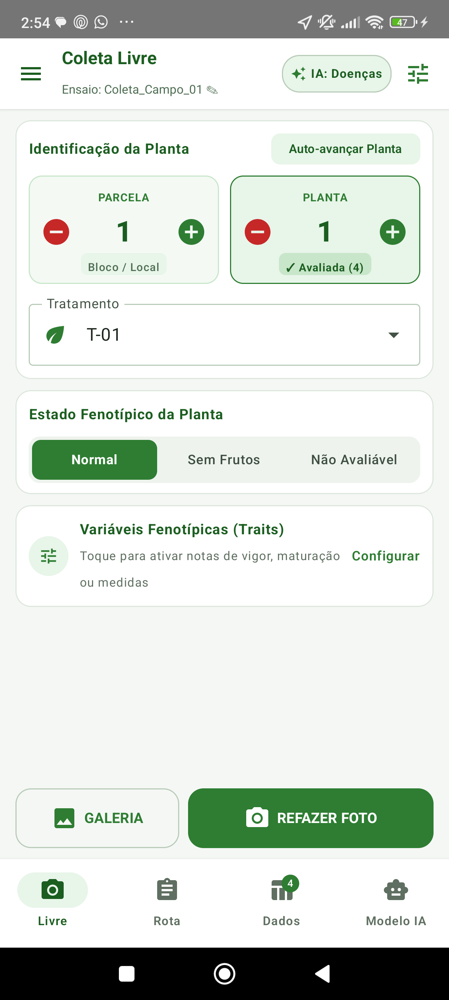



  
    
  

    <a href="#-sobre-mim"><b>Sobre mim</b></a> &nbsp;&bull;&nbsp;
    <a href="#-projetos-em-destaque"><b>Projetos em destaque</b></a> &nbsp;&bull;&nbsp;
    <a href="#-demonstrações-visuais"><b>Demonstrações</b></a> &nbsp;&bull;&nbsp;
    <a href="#-engenharia--qualidade"><b>Engenharia & Qualidade</b></a> &nbsp;&bull;&nbsp;
    <a href="#-tecnologias"><b>Tecnologias</b></a> &nbsp;&bull;&nbsp;
    <a href="#-contato"><b>Contato</b></a>
  

  

    
    
    
  

---

## 👋 Sobre mim

**Engenheiro de Software** com entrega ponta a ponta em **Mobile Nativo & Multiplataforma (Kotlin / Jetpack Compose & React Native)**, **Back-end Corporativo (Java 21 / Spring Boot 3)**, **Front-end Web (React / TypeScript)** e **IA Aplicada (Edge AI com YOLO / TensorFlow Lite & LLMs)**.

Projeto e construo sistemas voltados a cenários reais exigentes — de aplicativos Android **100% Offline-First** com inferência de Visão Computacional embarcada em áreas rurais sem internet, a APIs REST corporativas com segurança *stateless* JWT, bancos PostgreSQL versionados, auditoria visual em HTML5 Canvas e pipelines automatizados em GitHub Actions.

---

## 🚀 Projetos em destaque

### 1. Plataforma Open-Source & Ecossistema de Edge AI (**115 Testes Automatizados**)
> **Do Campo Institucional (CEPEC / CEPLAC) ao Produto Multi-Cultura:** O motor de Visão Computacional e Auditoria validado em pesquisa agronômica oficial (`CacauApp` + `CacauSync`) foi generalizado no **BreedAI**, um aplicativo standalone multi-culturas pronto para publicação na **Google Play**.

| Projeto | Arquitetura & Impacto Técnico | Stack & Qualidade |
| :--- | :--- | :--- |
| **[🧬 BreedAI](https://github.com/Igor8818/BreedAI)** *App Android Multi-Culturas (Open-Source • Play-Ready)* | Fenotipagem em campo inspirada no **Field Book** (`BreedAITheme` + `ModalNavigationDrawer` + 4 abas), **100% standalone e offline**. Possui motor **Universal YOLO/SSD** (`[1,C,N]`, `End2End NMS [1,N,6]`, `INT8`/`UINT8`/`FLOAT32`, leitura de metadados Ultralytics), parser nativo offline de **`.xlsx` (ZIP+SAX XML)**, *Traits* dinâmicos, importação/exportação de modelos em **`.zip`** e regras ProGuard/R8 para release. | `Kotlin 2.0` `Jetpack Compose` `CameraX` `TFLite` `YOLO Universal` `Excel .xlsx` **`31 Testes`** `CI` |
| **[🌱 CacauSync API](https://github.com/Igor8818/CacauSync)** *Back-end Corporativo & Painel Web React* | API RESTful corporativa e SPA Web em **React 18** para planejamento de rotas (`.xlsx`/`.csv`), sincronização idempotente em lote (HTTP e ponte automática **USB ADB** em 1 clique), segurança *stateless* **JWT (RBAC)**, **PostgreSQL 16 + Flyway** e auditoria visual com caixas YOLO em **HTML5 Canvas + zoom**. | `Java 21` `Spring Boot 3.3` `React 18` `TypeScript` `PostgreSQL 16` `Flyway` `Docker` **`51 Testes JUnit 5`** |
| **[📱 CacauApp](https://github.com/Igor8818/CacauApp)** *Mobile Edge AI Fitossanitário (CEPEC / CEPLAC)* | App Android dedicado ao ensaio clonal `TC-1801` (104 clones, 940 plantas). Suporta **Pipeline Duplo simultâneo** (Contagem + Diagnóstico de *Sadio*, *Vassoura de Bruxa*, *Podridão Parda* e *Monilíase*) com **Letterbox isomórfico**, *snap* geométrico pós-captura, auditoria *Human-in-the-Loop* e sincronização em 1 clique com o laboratório. | `Kotlin 2.0` `Jetpack Compose` `CameraX` `TFLite` `YOLOv8` `OkHttp` **`33 Testes`** `CI` |

---

### 2. Plataforma Full-Stack Autoral

| Projeto | Arquitetura & Impacto Técnico | Stack Principal |
| :--- | :--- | :--- |
| **[🏋️ FocusLift](https://github.com/Igor8818/focuslift)** *Full-Stack Mobile Offline-First & AI Coach* | Plataforma para progressão de cargas em treinos de força. Conecta cliente mobile **100% Offline-First (SQLite parametrizado)** a API REST em **Java 21 + Spring Boot 3.4** com sincronização bidirecional por *tombstones*, JWT, cálculo de 1RM e **AI Coach (Gemini 2.5 Flash)** blindado por motor determinístico em Java (`ProgressionMathEngine`) contra alucinações numéricas. | `Java 21` `Spring Boot 3.4` `PostgreSQL 16` `React Native` `Expo` `TypeScript` `SQLite` `Docker` `Gemini AI` |

---

### 3. Aplicações Web em Produção (Clientes)

* **[🩺 Claudia Fontes Enfermagem](https://github.com/Igor8818/Claudiaenfermagem)** — *Em produção ([claudiafontesenfermagem.vercel.app](https://claudiafontesenfermagem.vercel.app))*  
  Landing page institucional para consultório especializado com player de vídeo interativo, design responsivo e entrega via Edge CDN. (`HTML5` &bull; `Tailwind CSS` &bull; `JavaScript ES6+` &bull; `Vercel`)
* **[⚖️ Prof. Tales Almeida](https://github.com/Igor8818/tales)** — *Em produção ([proftalesalmeida.com](https://proftalesalmeida.com/))*  
  Website institucional e acervo acadêmico/jurídico desenvolvido sob encomenda em tema escuro com animações fluidas de rolagem. (`HTML5` &bull; `CSS3` &bull; `JavaScript`)

---

## 📸 Demonstrações visuais

  <table>
    <tr>
      <td align="center" width="50%" colspan="2">
        <b>🧬 BreedAI — Plataforma Multi-Culturas &amp; Edge AI</b>  
        
          
        
        &nbsp;&nbsp;
        
        &nbsp;&nbsp;
        
         
        UX agronômica inspirada no Field Book (esquerda/centro) e painel web de auditoria científica CacauSync (direita)
      </td>
    </tr>
    <tr>
      <td align="center" colspan="2">
        <b>📱 CacauApp — Detecção YOLOv8 &amp; Auditoria Fitossanitária em Campo</b>  
        <a href="https://github.com/Igor8818/CacauApp">
          
          &nbsp;&nbsp;
          
        </a>
         
        Inferência YOLOv8/TFLite on-device com snap geométrico pós-foto e classificação humana assistida 100% offline
      </td>
    </tr>
  </table>

---

## 🧠 Engenharia & Qualidade

* **Spec-Driven Development (SDD) & Contratos Cross-Stack:** Especificações formais (`docs/specs/SPEC-000` a `SPEC-003` + `REGRAS_DE_NEGOCIO.md`) assegurando concordância estrita entre payloads Android, CSV RFC 4180 e back-end Spring Boot.
* **Offline-First & Resiliência de Dados:** Persistência local com `AtomicFile`, chaves de idempotência contra quedas de rede e reconciliação bidirecional segura por *tombstones*.
* **Engine Edge AI On-Device:** Suporte unificado a modelos YOLO `FLOAT32`/`UINT8`/`INT8` e `End2End NMS [1,N,6]`, *Letterbox* isomórfico, reuso de buffers nativos e re-inferência estática pós-disparo.
* **Testes & Integração Contínua:** **115 testes automatizados** validados na JVM (`51` CacauSync + `33` CacauApp + `31` BreedAI) e builds automatizados em **GitHub Actions CI**.

---

## 🛠️ Tecnologias

| Área | Tecnologias & Ferramentas |
| :--- | :--- |
| **Back-end** | Java (21), Spring Boot 3, APIs RESTful, Spring Security (JWT), Spring Data JPA / Hibernate, Apache POI |
| **Front-end** | React 18, TypeScript, JavaScript (ES6+), Tailwind CSS, Vite, HTML5, CSS3 |
| **Mobile** | Kotlin 2.0, Jetpack Compose (Material 3), CameraX, React Native, Expo, Android SDK, Coroutines |
| **IA Aplicada** | Python, YOLOv8 / Universal YOLO, TensorFlow Lite (Edge AI On-Device), Google Gemini API, Spec-Driven Development |
| **Dados e DevOps** | PostgreSQL 16, SQLite, H2, Docker, Docker Compose, Flyway Migrations |
| **Testes & CI** | JUnit 4/5, Mockito, AssertJ, GitHub Actions CI, ProGuard/R8, Gradle, Maven, Git |

---

## 📬 Contato

* **LinkedIn:** [linkedin.com/in/igorhagge](https://www.linkedin.com/in/igorhagge/)
* **E-mail:** [igor.senna2@hotmail.com](mailto:igor.senna2@hotmail.com)
* **GitHub:** [github.com/Igor8818](https://github.com/Igor8818)
