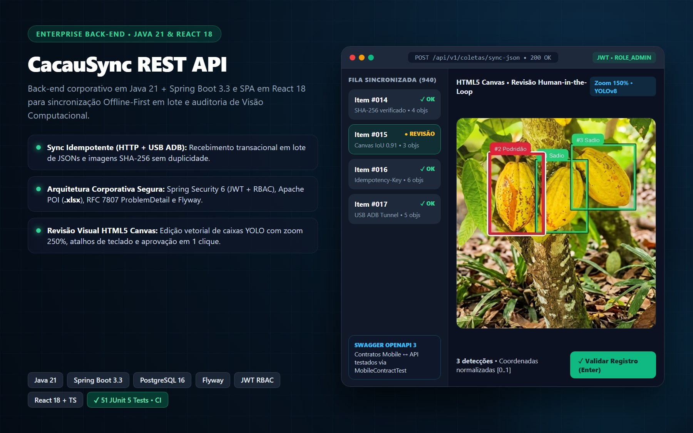
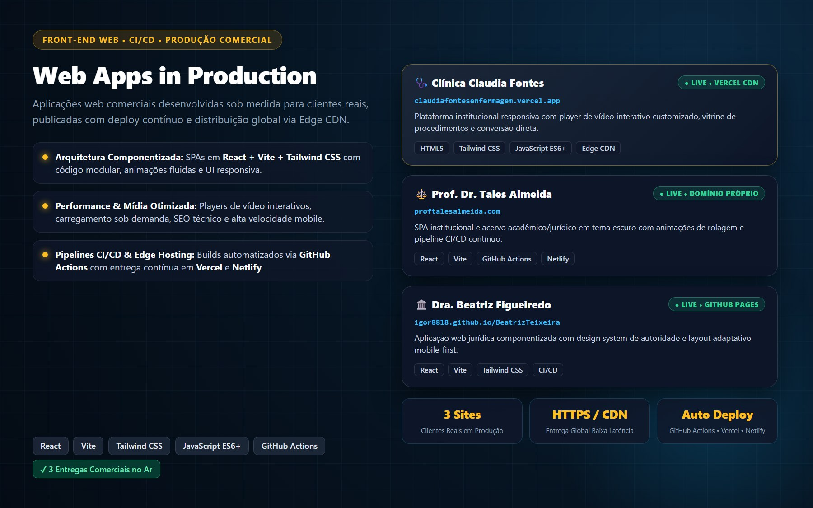

  
    
  

    <a href="#-sobre-mim"><b>Sobre mim</b></a> &nbsp;&bull;&nbsp;
    <a href="#-arquitetura--produtos-em-ação"><b>Demonstrações</b></a> &nbsp;&bull;&nbsp;
    <a href="#-projetos-em-destaque"><b>Projetos</b></a> &nbsp;&bull;&nbsp;
    <a href="#-engenharia--qualidade"><b>Engenharia &amp; Qualidade</b></a> &nbsp;&bull;&nbsp;
    <a href="#-tecnologias"><b>Stack</b></a> &nbsp;&bull;&nbsp;
    <a href="#-contato"><b>Contato</b></a>
  

  

    
    
    
  

  
🇺🇸 <b>Read in English — Executive Summary for Tech Recruiters &amp; Engineering Teams (203 Automated Tests)</b>

   
  

    <b>Software Engineer</b> building production-grade systems end-to-end across <b>Enterprise Back-end (Java 21, Spring Boot 3, PostgreSQL 16)</b>, <b>Native &amp; Cross-Platform Mobile (Kotlin / Jetpack Compose &amp; React Native / Expo)</b>, <b>Modern Web (React 18, TypeScript, Tailwind CSS)</b>, and <b>Applied AI (On-Device Edge AI with YOLO / TensorFlow Lite &amp; Guardrailed LLMs)</b>.
  

  <ul>
    <li><b>Full-Stack Cloud, Mobile &amp; Guardrailed AI:</b> Built <a href="https://github.com/Igor8818/focuslift">FocusLift</a> (Java 21 Virtual Threads + Spring Boot 3.4 + PostgreSQL 16 + React Native Offline-First SQLite, ACWR fatigue/injury engine, multi-turn AI Coach 2.0 with 1-tap routine builder, deterministic Java anti-hallucination guardrail, rate limiting, and global 5-language i18n (PT/EN/ES/DE/FR, kg/lbs) — 88 automated tests in CI: 24 JUnit 5 + 64 Vitest).</li>
    <li><b>Enterprise REST APIs &amp; Distributed Sync:</b> Architected <a href="https://github.com/Igor8818/CacauSync">CacauSync</a> (Java 21 + Spring Boot 3.3 + JWT RBAC + Flyway + React 18 SPA) with idempotent batch synchronization over HTTP and automated USB ADB tunnels, paired with native Android Edge AI clients (<a href="https://github.com/Igor8818/BreedAI">BreedAI</a> &amp; <a href="https://github.com/Igor8818/CacauApp">CacauApp</a> — 115 automated tests in CI).</li>
    <li><b>Production Web Deliveries:</b> Shipped 3 custom responsive web applications for real clients with automated CI/CD and global Edge CDN delivery on Vercel, Netlify &amp; GitHub Pages (<a href="https://claudiafontesenfermagem.vercel.app">Claudia Fontes Clinic</a>, <a href="https://proftalesalmeida.com">Prof. Tales Almeida</a>, and <a href="https://igor8818.github.io/BeatrizTeixeira/">Beatriz Figueiredo Law</a>).</li>
  </ul>

---

## 👋 Sobre mim

**Engenheiro de Software** com entrega ponta a ponta em **Back-end Corporativo (Java 21 & Spring Boot 3)**, **Mobile Nativo & Multiplataforma (Kotlin / Jetpack Compose & React Native / Expo)**, **Front-end Web (React 18 & TypeScript)** e **IA Aplicada (Visão Computacional On-Device & LLMs)**.

Projeto e construo sistemas resilientes orientados a performance, segurança e confiabilidade — desde **APIs REST *stateless* com JWT/RBAC, PostgreSQL + Flyway e sincronização idempotente em lote**, até **aplicativos 100% Offline-First**, **motores determinísticos anti-alucinação para IA generativa** e **pipelines automatizados em GitHub Actions CI**.

---

## 📸 Arquitetura & Produtos em Ação

  <table>
    <tr>
      <td align="center" width="50%">
        
         
        <b>🏋️ FocusLift</b> — API Spring Boot 3.4 + Mobile React Native/SQLite + Gemini AI c/ Guardrail Java
      </td>
      <td align="center" width="50%">
        
         
        <b>⚡ CacauSync</b> — API REST Java 21 + JWT/RBAC + Sync Idempotente + SPA React 18 / HTML5 Canvas
      </td>
    </tr>
    <tr>
      <td align="center" width="50%">
        
         
        <b>📱 BreedAI &amp; Mobile Suite</b> — Kotlin 2.0 + Compose + Universal TFLite Runtime + Parser .XLSX Nativo
      </td>
      <td align="center" width="50%">
        
         
        <b>🌐 Web em Produção</b> — 3 Aplicações Comerciais no Ar (React, Vite, Tailwind CSS, Vercel &amp; Netlify)
      </td>
    </tr>
  </table>

---

## 🚀 Projetos em destaque

### 1. Sistemas Principais — Back-end, Full-Stack, Mobile & IA (**203 Testes Automatizados em CI**)

| Projeto | Arquitetura & Engenharia de Software | Stack & Qualidade |
| :--- | :--- | :--- |
| **[🏋️ FocusLift](https://github.com/Igor8818/focuslift)** *Full-Stack Cloud, Mobile & AI Coach* | Plataforma completa para progressão de treinos com APK publicado e i18n global em **5 idiomas (`PT/EN/ES/DE/FR`, `kg/lbs`)**. Conecta app **100% Offline-First (SQLite reativo)** a uma **API REST em Java 21 (Virtual Threads) + Spring Boot 3.4** com sincronização bidirecional via *tombstones*, autenticação JWT, rate limiting, observabilidade Actuator, **motor ACWR de fadiga/lesão** e **AI Coach 2.0 multi-turno (Gemini 2.5 Flash) com construtor de rotinas em 1 toque** blindado por guardrail determinístico anti-alucinação em Java (`ProgressionMathEngine`). | `Java 21` `Spring Boot 3.4` `PostgreSQL 16` `React Native` `Expo` `TypeScript` `SQLite` `Docker` **`88 Testes CI`** `(24 JUnit 5 + 64 Vitest)` |
| **[⚡ CacauSync API](https://github.com/Igor8818/CacauSync)** *Enterprise REST API & Painel React 18* | Back-end corporativo em **Java 21 + Spring Boot 3.3** integrado a SPA em **React 18 + TypeScript**. Implementa ingestão nativa de planilhas (`.xlsx` Apache POI / `.csv` RFC 4180), **sincronização em lote estritamente idempotente** (via HTTP e túnel automático **USB ADB**), segurança *stateless* **Spring Security JWT (RBAC)**, tratamento global **RFC 7807 (`ProblemDetail`)**, **PostgreSQL 16 + Flyway** e revisão vetorial de caixas YOLO em **HTML5 Canvas**. | `Java 21` `Spring Boot 3.3` `PostgreSQL 16` `Flyway` `JWT / RBAC` `React 18` `TypeScript` `Docker` **`51 Testes JUnit 5`** `CI` |
| **[🧬 BreedAI](https://github.com/Igor8818/BreedAI)** *Android Open-Source & Universal Edge AI* | Plataforma Android **100% standalone e sem servidor**, pronta para Google Play (R8/ProGuard). Possui **runtime Universal YOLO/SSD** capaz de carregar modelos `.tflite` customizados em tempo de execução (`[1,C,N]`, `End2End NMS [1,N,6]`, `INT8`/`UINT8`/`FLOAT32`, metadados Ultralytics), **parser streaming nativo de Excel (`.xlsx` via ZIP + SAX XML)** sem dependências pesadas, schemas dinâmicos e pacotes `.zip` plugáveis. | `Kotlin 2.0` `Jetpack Compose` `CameraX` `TensorFlow Lite` `Coroutines` `MIT License` **`31 Testes`** `CI` |
| **[📱 CacauApp](https://github.com/Igor8818/CacauApp)** *Android Offline-First & Dual-Model CV* | Aplicativo Android nativo projetado para operação crítica sem internet em aparelhos de entrada. Executa **pipeline duplo de Visão Computacional YOLOv8 em tempo real**, pré-processamento por **Letterbox isomórfico (`640x640`)** com *snap* geométrico pós-captura, editor interativo *Human-in-the-Loop* em tela cheia, persistência atômica (`AtomicFile`) e auto-descoberta de rede `/24` + ponte USB para sync em 1 clique. | `Kotlin 2.0` `Jetpack Compose` `CameraX` `TensorFlow Lite` `YOLOv8` `OkHttp` **`33 Testes`** `CI` |

---

### 2. Aplicações Web em Produção (Entregas Comerciais)

* **[🩺 Claudia Fontes Enfermagem](https://github.com/Igor8818/Claudiaenfermagem)** — *Em produção ([claudiafontesenfermagem.vercel.app](https://claudiafontesenfermagem.vercel.app))*
  Aplicação web institucional com player de vídeo interativo, arquitetura responsiva mobile-first e entrega global via Edge CDN. (`HTML5` &bull; `Tailwind CSS` &bull; `JavaScript ES6+` &bull; `Vercel`)
* **[⚖️ Prof. Tales Almeida](https://github.com/Igor8818/tales)** — *Em produção ([proftalesalmeida.com](https://proftalesalmeida.com/))*
  SPA institucional e acervo digital em tema escuro com animações fluidas e pipeline automatizado de build e deploy contínuo. (`React` &bull; `Vite` &bull; `JavaScript` &bull; `CSS3` &bull; `GitHub Actions` &bull; `Netlify`)
* **[🏛️ Dra. Beatriz Figueiredo — Advocacia](https://github.com/Igor8818/BeatrizTeixeira)** — *Publicado ([igor8818.github.io/BeatrizTeixeira](https://igor8818.github.io/BeatrizTeixeira/))*
  Aplicação web modular componentizada com design responsivo e deploy automatizado via GitHub Pages. (`React` &bull; `Vite` &bull; `Tailwind CSS` &bull; `JavaScript`)

---

## 🧠 Engenharia & Qualidade

* **Arquitetura Limpa & Contratos Cross-Stack (SDD):** Especificações técnicas formais (`SPEC-000` a `SPEC-003`) e testes de contrato (`MobileContractTest`) garantindo compatibilidade estrita entre clientes mobile, payloads JSON/CSV RFC 4180 e APIs Spring Boot.
* **Sistemas Offline-First & Sincronização Distribuída:** Escrita local transacional (`SQLite` e `AtomicFile`), chaves de idempotência contra retransmissões em redes instáveis, pareamento de mídia por hash `SHA-256` e reconciliação bidirecional por *tombstones*.
* **Segurança Corporativa & Persistência Versionada:** Autenticação *stateless* via Bearer Token **JWT com RBAC** (`Spring Security 6`), respostas padronizadas de erro (`RFC 7807 ProblemDetail`), containers **Docker** e migrações versionadas em **PostgreSQL 16 + Flyway**.
* **IA Aplicada em Produção (Edge AI & LLM Guardrails):** Inferência *on-device* otimizada (~34 ms/frame com reuso de buffers nativos e quantização `INT8`/`FLOAT32`) e integração com LLMs protegida por validação matemática determinística em Java.
* **Testes Automatizados & CI/CD:** **203 testes automatizados** (`88` FocusLift [24 JUnit 5 + 64 Vitest] + `51` CacauSync + `33` CacauApp + `31` BreedAI) — **100% dos 4 sistemas principais com pipelines ativos em GitHub Actions CI**.

---

## 🛠️ Tecnologias

| Área | Tecnologias & Ferramentas |
| :--- | :--- |
| **Back-end** | Java 21, Spring Boot 3, Spring Security 6 (JWT / RBAC), Spring Data JPA / Hibernate, REST APIs (RFC 7807 / OpenAPI 3), Apache POI |
| **Front-end** | React 18, TypeScript, JavaScript (ES6+), Tailwind CSS, Vite, HTML5 Canvas, CSS3 |
| **Mobile** | Kotlin 2.0, Jetpack Compose (Material 3), CameraX, Coroutines, React Native, Expo, SQLite |
| **Dados & DevOps** | PostgreSQL 16, SQLite, H2, Flyway Migrations, Docker, Docker Compose, Vercel, Netlify |
| **IA & Edge Computing** | Python, TensorFlow Lite (On-Device Runtime), YOLO / SSD Object Detection, Google Gemini API, Deterministic Guardrails |
| **Testes & CI/CD** | JUnit 5, Mockito, AssertJ, Vitest, GitHub Actions CI, ProGuard / R8, Maven, Gradle, Git |

---

## 📬 Contato

* **LinkedIn:** [linkedin.com/in/igorhagge](https://www.linkedin.com/in/igorhagge/)
* **E-mail:** [igor.senna2@hotmail.com](mailto:igor.senna2@hotmail.com)
* **GitHub:** [github.com/Igor8818](https://github.com/Igor8818)
