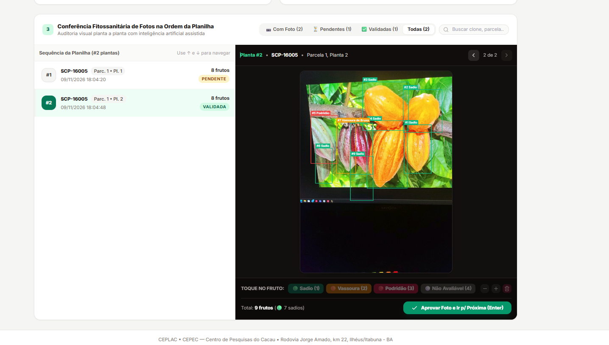



  
    
  

    <a href="#-sobre-mim"><b>Sobre mim</b></a> &nbsp;&bull;&nbsp;
    <a href="#-projetos-em-destaque"><b>Projetos em destaque</b></a> &nbsp;&bull;&nbsp;
    <a href="#-demonstrações-visuais"><b>Demonstrações</b></a> &nbsp;&bull;&nbsp;
    <a href="#-engenharia--qualidade"><b>Engenharia & Qualidade</b></a> &nbsp;&bull;&nbsp;
    <a href="#-tecnologias"><b>Tecnologias</b></a> &nbsp;&bull;&nbsp;
    <a href="#-contato"><b>Contato</b></a>
  

  

    
    
    
  

---

## 👋 Sobre mim

Sou **Engenheiro de Software** com atuação ponta a ponta em **Back-end (Java 21 & Spring Boot 3)**, **Mobile Nativo & Multiplataforma (Kotlin/Jetpack Compose & React Native/Expo)**, **Front-end Web (React & TypeScript)** e **Inteligência Artificial Aplicada (Edge AI com YOLOv8/TFLite & LLMs)**.

Construo sistemas resilientes orientados a problemas reais — desde aplicativos **Offline-First** rodando modelos de Visão Computacional *on-device* em áreas rurais sem conectividade, até APIs REST corporativas com segurança *stateless* JWT, bancos relacionais com migrações versionadas e painéis web interativos.

---

## 🚀 Projetos em destaque

### 1. Ecossistema de Edge AI, Fenotipagem Digital & Pesquisa Agronômica (**110 Testes Automatizados**)
> **Da Pesquisa Aplicada ao Produto Open-Source:** O ecossistema nasceu em campo com o **Centro de Pesquisas do Cacau (CEPEC / CEPLAC)** (`CacauApp` + `CacauSync`) e evoluiu para o **BreedAI**, uma plataforma *open-source* generalista e standalone para fenotipagem multi-culturas com modelos `.tflite` portáveis.

| Projeto | Papel & Destaques de Engenharia | Stack & Qualidade |
| :--- | :--- | :--- |
| **[🧬 BreedAI](https://github.com/Igor8818/BreedAI)** *Mobile: Multi-Culturas & Edge AI (Open-Source)* | Evolução generalista inspirada no *Field Book*, **100% standalone e offline** para qualquer cultura agrícola. Possui leitura nativa offline de **`.xlsx` (Excel via ZIP + SAX XML)** e `.csv`/`.tsv`, variáveis fenotípicas dinâmicas em tempo de execução, situação agronômica da planta (`Normal`, `Sem Frutos`, `Não avaliável`), importação/exportação de **pacotes `.zip`** de modelos e dois modelos **YOLOv8 Float32** pré-carregados com refinamento morfológico pós-NMS. | `Kotlin 2.0` `Jetpack Compose` `CameraX` `TensorFlow Lite` `YOLOv8` `Excel .xlsx` `27 Testes` `GitHub Actions CI` |
| **[📱 CacauApp](https://github.com/Igor8818/CacauApp)** *Mobile: Edge AI Fitossanitário (CEPEC / CEPLAC)* | App Android *Offline-First* dedicado ao ensaio clonal `TC-1801` (104 clones CEPEC, 940 plantas). Executa inferência multi-classe (*Sadio*, *Vassoura de Bruxa*, *Podridão Parda*, *Monilíase*) com **Letterbox isomórfico** e *snap* geométrico pós-captura, revisão *Human-in-the-Loop* em tela cheia, Modo Rota por planilha/USB e sincronização em 1 clique via HTTP/ADB. | `Kotlin 2.0` `Jetpack Compose` `CameraX` `TensorFlow Lite` `YOLOv8` `OkHttp` `32 Testes` `GitHub Actions CI` |
| **[🌱 CacauSync API](https://github.com/Igor8818/CacauSync)** *Full-Stack: Back-end Corporativo & Painel React* | API RESTful corporativa e SPA Web em React 18 para planejamento de rotas (`.xlsx`/`.csv`), sincronização idempotente em lote (HTTP e ponte automática **USB ADB** em 1 clique), autenticação stateless **JWT (RBAC)**, banco PostgreSQL 16 + Flyway e conferência visual com sobreposição de caixas YOLO em HTML5 Canvas + zoom. | `Java 21` `Spring Boot 3.3` `React 18` `TypeScript` `Tailwind CSS` `PostgreSQL 16` `Flyway` `Docker` `51 Testes JUnit 5` |

---

### 2. Plataforma Full-Stack Autoral
> **Produto Full-Stack Completo:** Mobile Offline-First sincronizado com API REST em nuvem e *AI Coach* blindado por cálculo determinístico.

| Projeto | Papel & Destaques de Engenharia | Stack Principal |
| :--- | :--- | :--- |
| **[🏋️ FocusLift](https://github.com/Igor8818/focuslift)** *Full-Stack Gym & AI Analytics* | Plataforma para rastreamento de treinos e sobrecarga progressiva. Integra aplicativo mobile **100% Offline-First (SQLite local)** a uma **API REST em Java 21 & Spring Boot 3.4** com sincronização bidirecional via *tombstones*, autenticação JWT, cálculo local de 1RM e *AI Coach* (**Gemini 2.5 Flash**) protegido por motor matemático determinístico em Java (`ProgressionMathEngine`). | `Java 21` `Spring Boot 3.4` `PostgreSQL 16` `React Native` `Expo` `TypeScript` `SQLite` `Docker` `Gemini AI` |

---

### 3. Aplicações Web em Produção (Clientes)
> **Entregas Comerciais:** Websites institucionais e acervos digitais contratados e publicados em produção.

* **[🩺 Claudia Fontes Enfermagem](https://github.com/Igor8818/Claudiaenfermagem)** — *Em produção ([claudiafontesenfermagem.vercel.app](https://claudiafontesenfermagem.vercel.app))*  
  Landing page institucional para consultório especializado, com player de vídeo interativo, layout responsivo e deploy em Edge CDN. (`HTML5` • `Tailwind CSS` • `JavaScript ES6+` • `Vercel`)
* **[⚖️ Prof. Tales Almeida](https://github.com/Igor8818/tales)** — *Em produção ([proftalesalmeida.com](https://proftalesalmeida.com/))*  
  Website institucional e acervo acadêmico/jurídico desenvolvido sob encomenda em tema escuro com animações fluidas de rolagem. (`HTML5` • `CSS3` • `JavaScript`)

---

## 📸 Demonstrações visuais

  <table>
    <tr>
      <td align="center" width="50%">
        <b>🧬 BreedAI — Fenotipagem Multi-Culturas &amp; Edge AI</b>  
        
         
        App Android standalone estilo Field Book com leitura nativa de .xlsx/.csv, pacotes de modelos .zip e YOLOv8 multi-classe
      </td>
      <td align="center" width="50%">
        <b>🌱 CacauSync — Painel Web de Auditoria Fitossanitária</b>  
        
         
        Conferência sequencial na ordem da planilha com caixas YOLO em HTML5 Canvas, edição de frutos e aprovação em 1 clique
      </td>
    </tr>
    <tr>
      <td align="center" colspan="2">
        <b>📱 CacauApp — Visão Computacional On-Device em Quadra Experimental</b>  
        <a href="https://github.com/Igor8818/CacauApp">
          
          &nbsp;&nbsp;
          
        </a>
         
        Inferência YOLOv8/TFLite em tempo real com snap geométrico pós-foto, classificação humana assistida e Modo Rota 100% offline
      </td>
    </tr>
  </table>

---

## 🧠 Engenharia & Qualidade

* **Spec-Driven Development (SDD) & Contratos Cross-Stack:** Especificações formais (`docs/specs/SPEC-000` a `SPEC-003` + `REGRAS_DE_NEGOCIO.md`) garantindo concordância estrita entre payloads Android, contratos CSV RFC 4180 e back-end Spring Boot.
* **Offline-First & Persistência Resiliente:** Escrita atômica (`AtomicFile`), chaves estritas de idempotência contra falhas de rede/conexão instável e reconciliação segura por *tombstones*.
* **Otimização Edge AI On-Device:** Pré-processamento por Letterbox isomórfico sem achatamento de proporção, NMS customizado, refinamento morfológico pós-NMS, reuso de `ByteBuffer`/`IntArray` pré-alocados e re-inferência estática de alta resolução pós-disparo.
* **Testes & Integração Contínua:** **110 testes automatizados** somando **CacauSync** (`51` JUnit 5/Mockito/AssertJ), **CacauApp** (`32` unitários) e **BreedAI** (`27` unitários), além de workflows automatizados de build e testes em **GitHub Actions CI**.

---

## 🛠️ Tecnologias

| Área | Tecnologias & Ferramentas |
| :--- | :--- |
| **Back-end** | Java (21), Spring Boot 3, APIs RESTful, Spring Security (JWT), Spring Data JPA / Hibernate, Apache POI |
| **Front-end** | React 18, TypeScript, JavaScript (ES6+), Tailwind CSS, Vite, HTML5, CSS3 |
| **Mobile** | Kotlin 2.0, Jetpack Compose (Material 3), CameraX, React Native, Expo, Android SDK, Coroutines |
| **IA Aplicada** | Python, YOLOv8, TensorFlow Lite (Edge AI On-Device), Google Gemini API, Spec-Driven Development |
| **Dados e DevOps** | PostgreSQL 16, SQLite, H2, Docker, Docker Compose, Flyway Migrations |
| **Testes & CI** | JUnit 4/5, Mockito, AssertJ, GitHub Actions CI, Gradle, Maven, Git |

---

## 📬 Contato

* **LinkedIn:** [linkedin.com/in/igorhagge](https://www.linkedin.com/in/igorhagge/)
* **E-mail:** [igor.senna2@hotmail.com](mailto:igor.senna2@hotmail.com)
* **GitHub:** [github.com/Igor8818](https://github.com/Igor8818)
