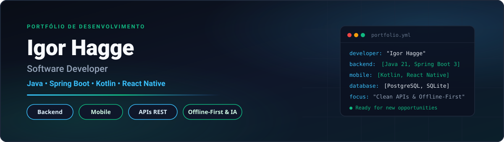

  
    
  

    <a href="#-sobre-mim"><b>Sobre mim</b></a> &nbsp;&bull;&nbsp;
    <a href="#-projetos-em-destaque"><b>Projetos em destaque</b></a> &nbsp;&bull;&nbsp;
    <a href="#-demonstrações-visuais"><b>Demonstrações</b></a> &nbsp;&bull;&nbsp;
    <a href="#-tecnologias"><b>Tecnologias</b></a> &nbsp;&bull;&nbsp;
    <a href="#-contato"><b>Contato</b></a>
  

---

## 👋 Sobre mim

Olá! Desenvolvo aplicações **back-end (Java 21 & Spring Boot 3)** e **mobile (Kotlin Nativo & React Native)**, com foco em soluções práticas, integração de sistemas e qualidade de código.
Construo APIs REST seguras, bancos de dados relacionais versionados e aplicativos *Offline-First* capazes de operar sem internet em campo e sincronizar dados com consistência.

---

## 🚀 Projetos em destaque

### 1. Ecossistema de Pesquisa Agronômica — CEPEC / CEPLAC
> **Contexto Institucional:** Solução integrada (Mobile + API + Painel Web) desenvolvida como projeto de pesquisa aplicada e validação em campo para o **Centro de Pesquisas do Cacau (CEPEC/CEPLAC)**, voltada à fenotipagem digital em quadras experimentais sem sinal de internet.

| Projeto | Papel & Arquitetura | Stack Principal |
| :--- | :--- | :--- |
| **[🌱 CacauSync API](https://github.com/Igor8818/CacauSync)** *Back-end & Painel de Auditoria* | API RESTful corporativa e SPA Web para planejamento de rotas (`.xlsx`/`.csv`), sincronização idempotente em lote (HTTP e ponte USB ADB em 1 clique), autenticação stateless JWT (RBAC) e conferência visual de fotos com caixas YOLO em HTML5 Canvas. Conta com **51 testes automatizados (JUnit 5, Mockito e AssertJ)**. | `Java 21` `Spring Boot 3.3` `PostgreSQL 16` `Flyway` `Spring Security (JWT)` `React 18` `Docker` `JUnit 5` |
| **[📱 CacauApp](https://github.com/Igor8818/CacauApp)** *Android Nativo & Visão Computacional* | Aplicativo Android *Offline-First* para contagem e classificação fitossanitária de frutos de cacau em campo usando **YOLOv8 (TensorFlow Lite)** no dispositivo, revisão interativa (*Human-in-the-Loop*), Modo Rota guiado por planilha, geolocalização GPS e exportação/sincronização em lote. | `Kotlin 2.0` `Jetpack Compose` `CameraX` `TensorFlow Lite` `YOLOv8` `Coroutines` `Material 3` `MVVM` |

### 2. Plataforma Full-Stack Autoral
> **Contexto:** Produto autoral completo (Mobile + API REST em nuvem) projetado para demonstrar arquitetura Full-Stack moderna, sincronização offline-first e integração determinística com IA.

| Projeto | Papel & Arquitetura | Stack Principal |
| :--- | :--- | :--- |
| **[🏋️ FocusLift](https://github.com/Igor8818/focuslift)** *Full-Stack Gym & AI Analytics* | Plataforma para rastreamento de treinos e sobrecarga progressiva. Une um app mobile **100% Offline-First (SQLite)** a uma **API REST em Java 21 & Spring Boot 3.4** com sincronização bidirecional via *tombstones*, autenticação JWT e *AI Coach* (**Gemini 2.5 Flash**) apoiado por motor matemático determinístico em Java (`ProgressionMathEngine`). | `Java 21` `Spring Boot 3.4` `PostgreSQL 16` `React Native` `Expo` `TypeScript` `SQLite` `Docker` |

### 3. Aplicações Web em Produção (Trabalhos para Clientes)
> **Contexto Comercial:** Projetos contratados e entregues em produção para profissionais liberais e consultórios.

* **[🩺 Claudia Fontes Enfermagem](https://github.com/Igor8818/Claudiaenfermagem)** — *Em produção ([claudiafontesenfermagem.vercel.app](https://claudiafontesenfermagem.vercel.app))*  
  Landing page institucional para consultório especializado, com player de vídeo interativo, design responsivo e deploy em Edge CDN. (`HTML5` • `Tailwind CSS` • `JavaScript ES6+` • `Vercel`)
* **[⚖️ Prof. Tales Almeida](https://github.com/Igor8818/tales)** — *Em produção ([proftalesalmeida.com](https://proftalesalmeida.com/))*  
  Website institucional e acervo acadêmico/jurídico desenvolvido sob encomenda com tema escuro e animações fluidas. (`HTML5` • `CSS3` • `JavaScript`)

---

## 📸 Demonstrações visuais

  <table>
    <tr>
      <td align="center" width="50%">
        <b>🌱 CacauSync API — Arquitetura Back-end & Auditoria</b>  
        
         
        API Spring Boot 3.3 + Painel React 18 + 51 Testes JUnit 5
      </td>
      <td align="center" width="50%">
        <b>📱 CacauApp — Visão Computacional & Coleta Offline</b>  
        
         
        Detecção YOLOv8 on-device e Modo Rota 100% offline
      </td>
    </tr>
  </table>

---

## 🛠️ Tecnologias

| Área | Tecnologias & Ferramentas |
| :--- | :--- |
| **Back-end & APIs** | Java 21, Spring Boot 3, Spring Security (JWT), Spring Data JPA / Hibernate, APIs RESTful, Validation, OpenAPI / Swagger |
| **Banco de Dados & DevOps** | PostgreSQL 16, SQLite, H2, Flyway Migrations, Docker, Docker Compose, Git, GitHub Actions, Maven, Gradle |
| **Mobile** | Kotlin, Jetpack Compose, Android SDK, CameraX, Coroutines, React Native, Expo, TypeScript, Arquitetura MVVM |
| **Qualidade & IA Aplicada** | JUnit 5, Mockito, AssertJ, TensorFlow Lite (YOLOv8 on-device), Google Gemini API |

---

## 📬 Contato

* **LinkedIn:** [linkedin.com/in/igorhagge](https://www.linkedin.com/in/igorhagge/)
* **E-mail:** [igor.senna2@hotmail.com](mailto:igor.senna2@hotmail.com)
* **GitHub:** [github.com/Igor8818](https://github.com/Igor8818)
