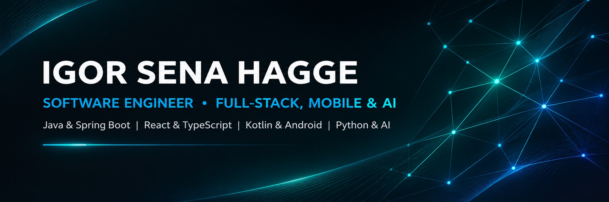
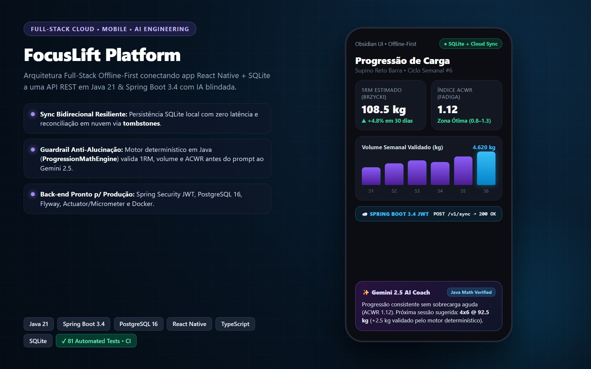
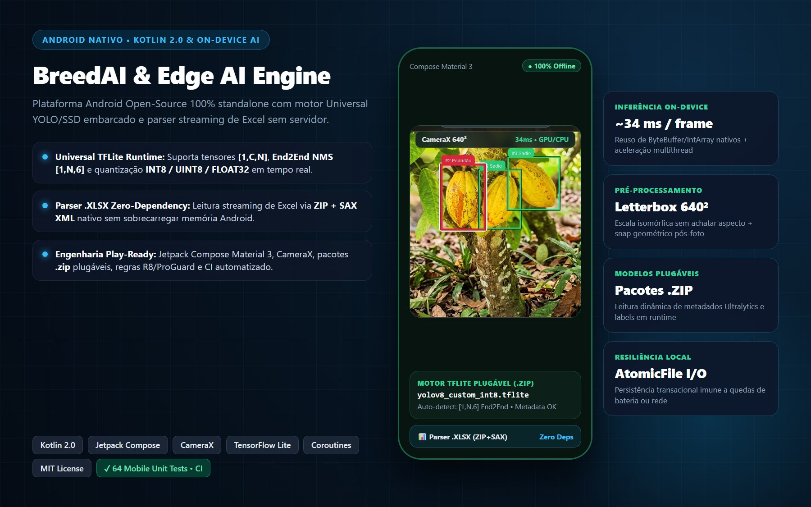

  
    
  

    <a href="#-sobre-mim--about-me"><b>Sobre mim</b></a> &nbsp;&bull;&nbsp;
    <a href="#-arquitetura--produtos-em-ação"><b>Demonstrações</b></a> &nbsp;&bull;&nbsp;
    <a href="#-sistemas-em-destaque--flagship-systems"><b>Projetos</b></a> &nbsp;&bull;&nbsp;
    <a href="#-engenharia--qualidade"><b>Engenharia &amp; Qualidade</b></a> &nbsp;&bull;&nbsp;
    <a href="#-stack-principal--core-tech-stack"><b>Stack</b></a> &nbsp;&bull;&nbsp;
    <a href="#-contato"><b>Contato</b></a>
  

  

    
    
    
  

  
🇺🇸 <b>Read in English — Executive Summary for Tech Recruiters &amp; Engineering Teams (299 Automated Tests)</b>

   
  

    <b>Software Engineer (Back-end Java/Spring Boot &amp; Mobile Kotlin/React Native)</b> building production systems for applied agricultural research at <b>CEPEC/CEPLAC</b> and commercial web deliveries. Experienced across <b>Enterprise REST APIs (Java 21, Spring Boot 3, PostgreSQL 16, Flyway, JWT/RBAC, Docker)</b>, <b>Offline-First Mobile Apps (Kotlin / Jetpack Compose MVVM &amp; React Native / SQLite)</b>, and <b>Applied AI (On-Device TFLite / YOLO &amp; Deterministic LLM Guardrails)</b> backed by <b>299 automated tests in GitHub Actions CI</b>.
  

  <ul>
    <li><b>Full-Stack Cloud, Mobile &amp; Guardrailed AI:</b> Built <a href="https://github.com/Igor8818/focuslift">FocusLift</a> (Java 21 Virtual Threads + Spring Boot 3.4 + PostgreSQL 16 + React Native Offline-First SQLite, ACWR fatigue/injury engine, multi-turn AI Coach 2.0, deterministic Java anti-hallucination guardrail, rate limiting, and 5-language i18n — <b>99 automated tests in CI</b>: 24 JUnit 5 + 75 Vitest).</li>
    <li><b>Enterprise REST APIs &amp; Distributed Sync:</b> Architected <a href="https://github.com/Igor8818/CacauSync">CacauSync</a> (Java 21 + Spring Boot 3.3 + JWT/RBAC + Flyway + React 18 SPA — <b>61 JUnit 5 tests</b>) with idempotent batch synchronization over HTTP and automated USB ADB tunnels, paired with native Android Edge AI clients (<a href="https://github.com/Igor8818/BreedAI">BreedAI</a> MVVM/Compose — <b>85 tests</b> &amp; <a href="https://github.com/Igor8818/CacauApp">CacauApp</a> MVVM/Compose — <b>54 tests</b>).</li>
    <li><b>Live Commercial Web Deliveries:</b> Shipped 3 custom responsive web applications for real clients with automated CI/CD on Vercel, Netlify &amp; GitHub Pages (<a href="https://proftalesalmeida.com/">Prof. Tales Almeida</a>, <a href="https://claudiafontesenfermagem.vercel.app">Cláudia Fontes Clinic</a>, and <a href="https://igor8818.github.io/BeatrizTeixeira/">Beatriz Figueiredo Law</a>).</li>
  </ul>

---

## 👨‍💻 Sobre mim | About Me

🇧🇷 **Engenheiro de Software (Back-end Java/Spring Boot & Mobile Kotlin/React Native)** com atuação em sistemas de pesquisa aplicada no **CEPEC/CEPLAC** (Centro de Pesquisas do Cacau) e entregas comerciais em produção.
Construo **APIs REST corporativas (Java 21, Spring Boot 3, PostgreSQL 16, Flyway, JWT/RBAC, Docker)** integradas a **aplicativos móveis 100% Offline-First**, **Visão Computacional On-Device (TensorFlow Lite / YOLO)** e **pipelines automatizados com 299 testes em CI**.

🇺🇸 **Software Engineer** delivering end-to-end systems from **stateless Java 21 / Spring Boot 3 REST APIs** to **Offline-First Android (Kotlin/Jetpack Compose MVVM)** and **React Native** clients with on-device Edge AI and deterministic LLM guardrails.

---

## 📸 Arquitetura & Produtos em Ação

  <table>
    <tr>
      <td align="center" width="50%">
        
         
        <b>⚡ CacauSync</b> — API REST Java 21 + JWT/RBAC + Sync Idempotente + SPA React 18 / HTML5 Canvas
      </td>
      <td align="center" width="50%">
        
         
        <b>🏋️ FocusLift</b> — API Spring Boot 3.4 + Mobile React Native/SQLite + Gemini AI c/ Guardrail Java
      </td>
    </tr>
    <tr>
      <td align="center" width="50%">
        
         
        <b>🧬 BreedAI &amp; Mobile Suite</b> — Kotlin 2.0 + Compose MVVM + Universal TFLite Runtime + Parser .XLSX Nativo
      </td>
      <td align="center" width="50%">
        
         
        <b>🌐 Web em Produção</b> — 3 Aplicações Comerciais no Ar (React, Vite, Tailwind CSS, Vercel &amp; Netlify)
      </td>
    </tr>
  </table>

---

## 🏆 Sistemas em Destaque | Flagship Systems

### 1. Sistemas Principais — Back-end, Full-Stack, Mobile & IA (**299 Testes Automatizados**)

| Sistema | Problema Real & Arquitetura | Stack & Prova de Qualidade |
| :--- | :--- | :--- |
| **[⚡ CacauSync API](https://github.com/Igor8818/CacauSync)** *Enterprise Back-end & React 18 SPA* | Plataforma corporativa em **Java 21 + Spring Boot 3.3** e **React 18 + TypeScript** para auditoria de ensaios genéticos no CEPEC/CEPLAC (940+ plantas / 104 clones). Inclui ingestão nativa de planilhas (`.xlsx` Apache POI / `.csv` RFC 4180), **sincronização em lote estritamente idempotente** (HTTP e túnel automático **USB ADB** dual-package), **Spring Security JWT (RBAC)**, erros **RFC 7807 (`ProblemDetail`)**, **PostgreSQL 16 + Flyway** e revisão vetorial em **HTML5 Canvas**. | `Java 21` `Spring Boot 3.3` `PostgreSQL 16` `Flyway` `JWT / RBAC` `React 18` `TypeScript` `Docker` **`61 Testes JUnit 5`** `CI` |
| **[🏋️ FocusLift](https://github.com/Igor8818/focuslift)** *Full-Stack Cloud, Mobile & AI Coach* | Plataforma completa de progressão de treinos em **5 idiomas (`PT/EN/ES/DE/FR`, `kg/lbs`)** com APK publicado. Conecta app **100% Offline-First (SQLite reativo)** a API **Java 21 (Virtual Threads) + Spring Boot 3.4** com sincronização bidirecional via *tombstones*, autenticação JWT, rate limiting, observabilidade Actuator, **motor ACWR de fadiga/lesão** e **AI Coach 2.0 multi-turno (Gemini 2.5 Flash)** blindado por guardrail determinístico em Java (`ProgressionMathEngine`). | `Java 21` `Spring Boot 3.4` `PostgreSQL 16` `React Native` `Expo` `TypeScript` `SQLite` `Docker` **`99 Testes CI`** `(24 JUnit 5 + 75 Vitest)` |
| **[🧬 BreedAI](https://github.com/Igor8818/BreedAI)** *Android Open-Source MVVM & Universal Edge AI* | Plataforma Android nativa (`com.igor.breedai`, arquitetura **MVVM com `BreedAIViewModel` + `StateFlow`** e build **R8/ProGuard** para Google Play). Executa **runtime Universal YOLO/SSD** em tempo real (`[1,C,N]`, `End2End NMS [1,N,6]`, `EfficientDet 2-out`, `INT8`/`UINT8`/`FLOAT32`, metadados Ultralytics), **parser streaming nativo de Excel (`.xlsx` via ZIP + SAX)**, conversão de rendimento comercial (`@`/kg/sc/cx), ranking por tratamento e exportação de pacote ZIP via *streaming*. | `Kotlin 2.0` `Jetpack Compose` `MVVM / StateFlow` `CameraX` `TensorFlow Lite` `MIT License` **`85 Testes Unitários`** `CI` |
| **[📱 CacauApp](https://github.com/Igor8818/CacauApp)** *Android Offline-First MVVM & Dual-Model CV* | Aplicativo Android nativo (`br.gov.ceplac.cepec.cacauapp`, arquitetura **MVVM com `CacauViewModel` + `StateFlow`**, build **R8/ProGuard**) utilizado em campo sem internet para contagem biométrica e diagnóstico fitossanitário do cacaueiro. Executa **pipeline duplo YOLOv8** (GPU Delegate + XNNPACK), pré-processamento por **Letterbox (`640x640`)** com *snap* geométrico pós-captura (*Human-in-the-Loop*), persistência atômica (`AtomicFile`), exportação ZIP via *streaming*, rendimento clonal (`@/ha`) e ponte HTTP `/24` + USB ADB para sync em 1 clique com o CacauSync. | `Kotlin 2.0` `Jetpack Compose` `MVVM / StateFlow` `CameraX` `TensorFlow Lite` `YOLOv8` `OkHttp` **`54 Testes Unitários`** `CI` |

---

## 🌐 Entregas Comerciais em Produção | Live Commercial Projects

* **[⚖️ Prof. Tales Almeida](https://proftalesalmeida.com/)** ([Repositório](https://github.com/Igor8818/tales)) — *Em produção*  
  SPA institucional e acervo acadêmico em tema escuro com animações fluidas e pipeline automatizado de build e deploy contínuo. (`React` &bull; `Vite` &bull; `JavaScript` &bull; `CSS3` &bull; `GitHub Actions` &bull; `Netlify`)
* **[🩺 Cláudia Fontes Enfermagem](https://claudiafontesenfermagem.vercel.app)** ([Repositório](https://github.com/Igor8818/Claudiaenfermagem)) — *Em produção*  
  Landing page clínica com player de vídeo interativo, arquitetura responsiva mobile-first e entrega global via Edge CDN. (`HTML5` &bull; `Tailwind CSS` &bull; `JavaScript ES6+` &bull; `Vercel`)
* **[🏛️ Dra. Beatriz Figueiredo — Advocacia](https://igor8818.github.io/BeatrizTeixeira/)** ([Repositório](https://github.com/Igor8818/BeatrizTeixeira)) — *Publicado*  
  Aplicação web modular componentizada com design responsivo e deploy automatizado via GitHub Pages. (`React` &bull; `Vite` &bull; `Tailwind CSS` &bull; `JavaScript`)

---

## 🧠 Engenharia & Qualidade

* **Arquitetura Limpa & Contratos Cross-Stack:** Separação em camadas (`Controller` → `Service` → `Repository`), arquitetura **MVVM (`ViewModel` + `StateFlow`)** no Android, especificações formais (`SPEC-000` a `SPEC-003`) e testes de contrato (`MobileContractTest`) entre clientes mobile, CSV RFC 4180 e APIs Spring Boot.
* **Sistemas Offline-First & Sincronização Distribuída:** Escrita local transacional (`SQLite` e `AtomicFile`), exportação ZIP via *streaming* anti-OOM, chaves de idempotência contra retransmissões em redes instáveis, pareamento de mídia por `SHA-256` e reconciliação bidirecional por *tombstones*.
* **Segurança Corporativa & Persistência Versionada:** Autenticação *stateless* via Bearer Token **JWT com RBAC** (`Spring Security 6`), respostas padronizadas de erro (`RFC 7807 ProblemDetail`), rate limiting, containers **Docker** e migrações versionadas em **PostgreSQL 16 + Flyway**.
* **IA Aplicada em Produção (Edge AI & LLM Guardrails):** Inferência *on-device* otimizada (CPU multithread + XNNPACK, reuso de buffers nativos e quantização `INT8`/`FLOAT32`) e integração com LLMs protegida por validação matemática determinística em Java.
* **Testes Automatizados & CI/CD:** **299 testes automatizados** (`99` FocusLift [24 JUnit 5 + 75 Vitest] + `85` BreedAI + `61` CacauSync + `54` CacauApp) — **100% dos 4 sistemas principais com pipelines ativos em GitHub Actions CI**.

---

## 🛠️ Stack Principal | Core Tech Stack

| Área | Tecnologias & Ferramentas |
| :--- | :--- |
| **Back-end** | Java 21, Spring Boot 3, Spring Security 6 (JWT / RBAC), Spring Data JPA / Hibernate, REST APIs (RFC 7807 / OpenAPI 3), Apache POI |
| **Front-end** | React 18, TypeScript, JavaScript (ES6+), Tailwind CSS, Vite, HTML5 Canvas, CSS3 |
| **Mobile** | Kotlin 2.0, Jetpack Compose (Material 3), MVVM (`ViewModel` + `StateFlow`), CameraX, Coroutines, React Native, Expo, SQLite |
| **Dados & DevOps** | PostgreSQL 16, SQLite, H2, Flyway Migrations, Docker, Docker Compose, Vercel, Netlify |
| **IA & Edge Computing** | Python, TensorFlow Lite (On-Device CPU + XNNPACK), YOLO / EfficientDet, Google Gemini API, Deterministic Guardrails |
| **Testes & CI/CD** | JUnit 5, JUnit 4, Mockito, AssertJ, Vitest, GitHub Actions CI, ProGuard / R8, Maven, Gradle, Git |

---

## 📬 Contato

* **LinkedIn:** [linkedin.com/in/igorhagge](https://www.linkedin.com/in/igorhagge/)
* **E-mail:** [igor.senna2@hotmail.com](mailto:igor.senna2@hotmail.com)
* **GitHub:** [github.com/Igor8818](https://github.com/Igor8818)
